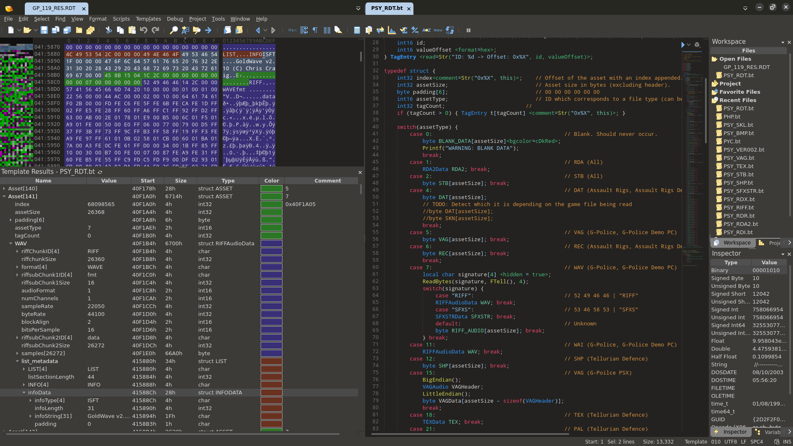

# psygnosis-templates
[010 Editor](https://www.sweetscape.com/010editor/) .bt templates for Psygnosis game data files

These are a bit rough, not all of them work fully/for all variants at the time of writing, some are incomplete or contain random comments etc.

They have however been extremely useful to me in figuring out file formats for [Owl](https://github.com/DASA-KAMOV/owl) and [Hangar](https://github.com/DASA-KAMOV/Hangar).

I will continue to update them as I continue researching and documenting various Psygnosis game data files.

Contributions welcome.

